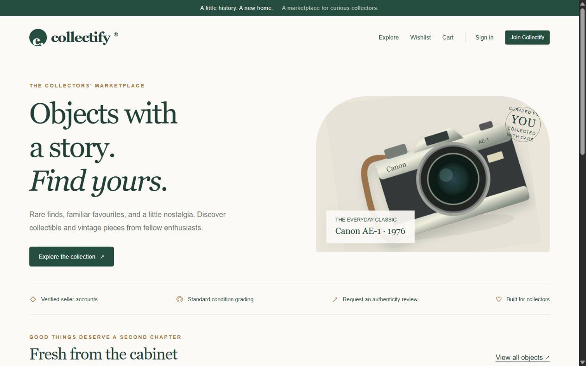
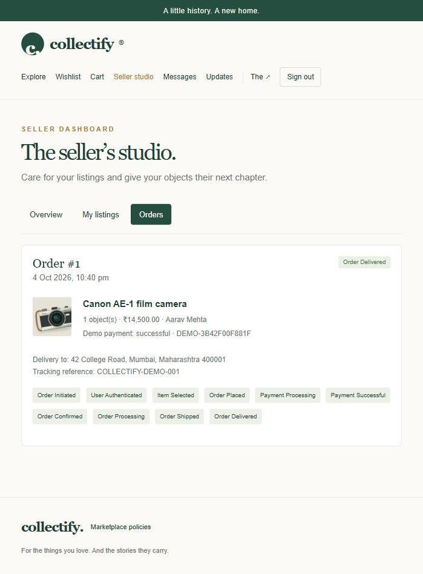
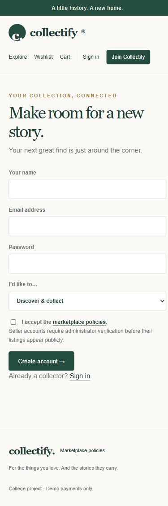

# Collectify

[](https://github.com/soumilpatro/collectify/actions/workflows/tests.yml)

A full-stack college software engineering project for buying, selling and reviewing collectible and vintage objects. Collectify connects a responsive marketplace interface to a Flask API and relational database, with separate buyer, seller and administrator workflows.

**Project status:** working local demonstration. Payments are simulated, tracking is entered by sellers, and authenticity badges record administrator documentation reviews rather than physical certification. No real money moves.



## What you can do

| Buyer | Seller | Administrator |
| --- | --- | --- |
| Browse, search, filter and view objects | Create, edit and remove listings | Verify or reject seller accounts |
| Save a wishlist and manage a cart | Upload photos and manage inventory | Approve, reject or remove listings |
| Complete successful or failed demo checkout | Accept, process, dispatch and deliver orders | Review authenticity requests |
| Track orders and cancel before shipment | Reply to buyer messages | Suspend or restore accounts |
| Review objects and request authenticity checks | View sales summaries and export CSV | Manage categories and resolve disputes |
| Message sellers and open disputes | Submit seller verification information | View platform order and sales reports |

Accounts also have editable profiles, in-app notifications and local password recovery.

## Run locally

Requires **Python 3.11 or newer**. Internet is needed for the first dependency installation. Styles, Bootstrap and product illustrations are served locally afterward.

### Windows

Clone or download and extract this repository, then double-click **start.bat** inside the project folder. It creates a virtual environment, installs missing packages and starts the server.

Or run:

```powershell
git clone https://github.com/soumilpatro/collectify.git
cd collectify
py -3 -m venv .venv
.venv\Scripts\python.exe -m pip install -r requirements.txt
.venv\Scripts\python.exe app.py
```

### macOS / Linux

```sh
git clone https://github.com/soumilpatro/collectify.git
cd collectify
python3 -m venv .venv
.venv/bin/python -m pip install -r requirements.txt
.venv/bin/python app.py
```

Open **http://127.0.0.1:5000** and keep the server running. This address works on the device running the server; the project is not currently hosted as a public website.

## Demo accounts

| Role | Email | Password |
| --- | --- | --- |
| Buyer | buyer@collectify.demo | Collectify123! |
| Seller | seller@collectify.demo | Collectify123! |
| Administrator | admin@collectify.demo | Collectify123! |

These are deliberately public **local-demo credentials**, not production secrets. Demo buttons fill the login form. Seed accounts and catalog items are created only when the database contains no users. New registrations may be buyers or sellers; public registration cannot create an administrator.

## Architecture and technology

| Layer | Implementation |
| --- | --- |
| Frontend | HTML5, CSS, vanilla JavaScript, vendored Bootstrap 5.3.8 |
| Backend | Python and Flask; JSON API with server-side validation and permissions |
| Persistence | SQLAlchemy; SQLite by default, configurable MySQL/PostgreSQL connections |
| Authentication | Werkzeug scrypt password hashes, signed sessions and CSRF tokens |
| Tests | Python unittest integration tests and JavaScript syntax validation |

The browser sends requests to the Flask API, which checks the user role and ownership before reading or changing relational records. User, product, order, payment, review, wishlist and authenticity entities follow the coursework class diagram. Additional tables support carts, messages, notifications, disputes and event history.

Prices use integer paise. Checkout reserves stock and creates all selected orders in one database transaction. A failure rolls back the entire transaction. Cancellation uses a guarded update to restore stock and record a demo refund once.

## Order lifecycle

```text
Order Initiated → User Authenticated → Item Selected → Order Placed
    → Payment Processing → Payment Successful → Order Confirmed
    → Order Processing → Order Shipped → Order Delivered

Payment Processing → Payment Failed
Before shipment: Order Placed / Confirmed / Processing → Order Cancelled
```

Each order preserves its state history. Failed payments keep the cart and do not reduce stock. Retrying creates a new checkout. Sellers cannot skip fulfillment stages, and buyers cannot cancel shipped or delivered orders.



## Software engineering documentation

The implementation was derived from the project's requirements, DFDs, use case specifications, statechart and class diagram.

- [Requirements and diagram-to-code mapping](REQUIREMENTS.md): all seven DFD processes, UC-01 through UC-15, state transitions, entities, assumptions and exclusions.
- [Setup, database configuration, backups and presentation walkthrough](docs/SETUP.md).
- [Verification record and known limits](VERIFICATION.md).

The original coursework documents are not redistributed in this repository. The mapping explains the designs in text. This is an academic project developed with AI-assisted implementation; it is not a production marketplace.

## Tests and continuous integration

```powershell
.venv\Scripts\python.exe -m unittest discover -s tests -v
```

On macOS/Linux use `.venv/bin/python` instead. GitHub Actions runs the integration suite on Python 3.11 and 3.13 and checks frontend JavaScript syntax on pushes and pull requests.

The 15 integration tests cover registration, password hashing, role and CSRF checks, search, persistent wishlists, cart limits, failed payments, order transitions, cancellation refunds, cross-buyer privacy, stock rollback, moderation, messages, reviews, authenticity requests, disputes, reports and upload validation. They use an isolated in-memory database, not the demo database. Local checks do not imply that the hosted CI workflow has already passed; inspect the Actions results.

## Project layout

```text
app.py                 Application setup and database sessions
models.py              Persistent entities
controllers.py         Marketplace API and workflow rules
seed.py                Fictional demo accounts and catalog
manage.py              Safe SQLite backup utility
static/                Frontend, vendored styles and local illustrations
tests/test_flows.py     Backend integration suite
docs/                  Setup guide and screenshots
.github/workflows/     Continuous integration
```

## Mobile layout



## Scope and limitations

- The default local SQLite database is created automatically. MySQL/PostgreSQL configuration is documented but was not exercised against an actual external server during the original verification.
- Password recovery prints a single-use token to the local server console. Email delivery is not integrated. Notifications are in-app rather than email/SMS.
- Authenticity is an administrator documentation review. Shipping updates and tracking references are manual. Catalog artwork is illustrative; sellers can upload photos.
- There are no live auctions, cryptocurrency, international shipping integration, physical certification, AI recommendations or price prediction.
- The current frontend and API are intentionally compact. Splitting the larger files into focused modules, adding database migrations, shared rate limiting and browser automation are sensible next improvements.
- Public hosting requires production configuration and a security review. Do not expose the seeded administrator credentials, development server or recovery console as a production service.

Runtime databases, uploaded photos, virtual environments, session keys and logs are excluded from version control. Bootstrap retains its upstream MIT notice; no open-source license has been selected for the application code.
